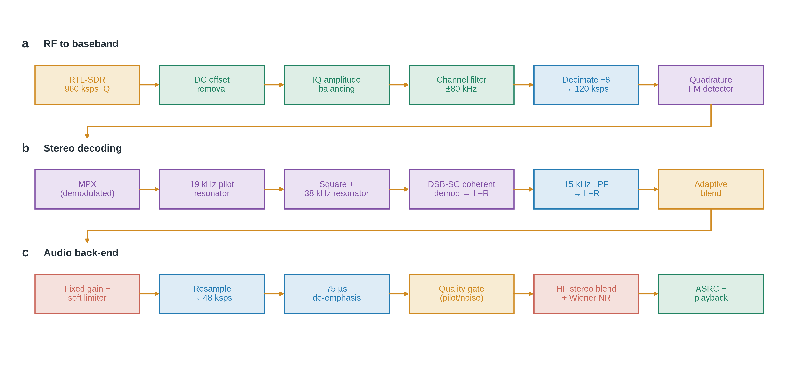
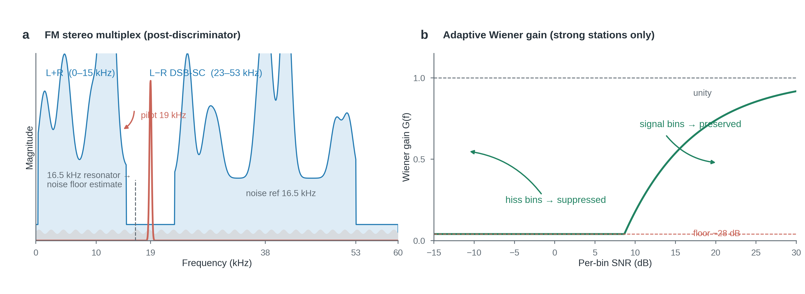

# 用 Python + RTL-SDR 复现 FM 广播收听

在 Windows 上用纯 Python(ctypes 直驱 RTL-SDR 官方 64 位 DLL)实现的一台完整 FM 立体声收音机:从 USB 采集、基带处理、立体声解码到自适应降噪与音频流播放,全部自己写 DSP,不依赖任何 SDR 框架。



## 硬件与依赖

| 项 | 内容 |
|---|---|
| 接收棒 | RTL-SDR(FC0013 调谐器,22–1100 MHz) |
| 驱动 | `rtlsdr_x64/rtlsdr.dll`(ctypes 直接调用 `rtlsdr_read_sync` 等 API) |
| Python | numpy、scipy、sounddevice |
| 参数 | 960 ksps 采样、增益 49.5 dB、0.25 s 数据块 |

本机自带的 32 位 DLL 无法被 64 位 Python 加载,故从 [rtlsdrblog 官方 Release](https://github.com/rtlsdrblog/rtl-sdr-blog/releases) 取 64 位版本。

## 信号处理链

### a. 射频到基带

1. **DC 偏移消除**:FC0013 是零中频调谐器,本振泄漏的直流尖峰正好压在信号中央,每块减均值消掉,否则直接抬噪声底。
2. **IQ 幅度平衡**:按 I/Q 两路功率的 EMA 估计实时归一,修正调谐器增益不平衡造成的镜像失真。
3. **信道滤波**:960 kHz 域 4 阶 Butterworth 低通 ±80 kHz,匹配 FM 广播信道带宽,压缩带外噪声。
4. **抽取 ÷8 → 120 ksps**:`resample_poly` 自带抗混叠,同时刻意保留 38 kHz 立体声副载波不混叠(直接抽到 48 kHz 会把副载波折叠进可听频段)。
5. **正交鉴频**:相邻样本共轭相乘取相位 `angle(x[n]·conj(x[n−1]))`,得到 FM 多路信号(multiplex, MPX)。

### b. FM 立体声解码



鉴频输出是广播标准立体声基带:**L+R(0–15 kHz)+ 19 kHz 导频 + L−R 抑制载波双边带(23–53 kHz)**。

1. **导频恢复**:19 kHz 窄带谐振器(数字二阶 BPF)从 MPX 中滤出导频。
2. **副载波重建**:导频平方产生 38 kHz 分量(相位自动锁定),再经 38 kHz 谐振器净化、归一化。
3. **相干解调**:MPX × 38 kHz 副载波 → 低通 → L−R。
4. **自适应立体声混合**:比较 L+R 与 L−R 通道功率比,弱信号时把 L−R 自动并入单声道(L−R 噪声是 L+R 的两倍),信号强时完全展开立体声。

### c. 音频后处理

1. **定增益 + tanh 软限幅**:替代逐块峰值归一化,消除音量"喘息"。
2. **重采样 48 kHz + 75 µs 去加重**:中国 FM 制式标准。
3. **质量门控**:第二个谐振器测 16.5 kHz 处(纯噪声区)的噪声功率,与导频功率之比作为信号质量 EMA——**只对强台启用下面的激进处理**。
4. **高频立体声混合**:3 kHz 以上成分 60% 并回单声道,直接砍掉差通道高频嘶声,低频保持立体声(人耳对高频声像不敏感)。
5. **维纳谱减降噪**:STFT 分帧(1024/512,√Hann 重叠相加),从 12 kHz 以上纯噪声段估计噪声底(EMA 平滑),逐频点最优增益 `G = clip(1 − 2.6·N/X, 0.04, 1)`,噪声频点压 −28 dB,信号频点不动。
6. **ASRC 时钟补偿**:RTL 实际采样率与标称 960 kHz 有约 4% 偏差(实测),按播放缓冲队列深度动态微调每块样本数(±10% 内),稳定实时流。

### 关键工程细节

- **所有 IIR 滤波器跨块保存状态(`zi`)**:否则每 0.25 s 块边界产生一次瞬态脉冲,表现为规律的"哒哒哒"。
- **降噪器用持久缓冲 + 滑动帧格**:样本严格守恒、重构无缝,否则每块丢 512 样本会拖慢生产速率导致周期性断流。
- **播放回调非阻塞 + 预缓冲 1 s**:音频回调里不做磁盘 I/O(录音移到独立线程),开播前先攒缓冲吸收 USB 抖动。

## 实测表现

- 97.4 MHz(本地强台):立体声分离生效(L/R 相关系数 0.82),嘶声经三层降噪后接近干净。
- 弱台自动退化为"稳健模式"(单声道 + 无谱减),不会像固定降噪链那样把声音压没。
- 长时间播放零欠载、零块边界杂音。

## 使用

```bash
python fm_radio.py            # 默认 100.6 MHz
python fm_radio.py 97.4       # 任意 FM 频率
python scan_fm.py             # 扫描 85–110 MHz,存 fm_stations.csv
FM_NR=1 python fm_radio.py    # 强制启用谱减降噪
```

收听同时自动录制 `fm_<频率>MHz.wav`(48 kHz 立体声)。

## 文件

| 文件 | 说明 |
|---|---|
| `fm_radio.py` | 收音机主程序(全部 DSP) |
| `scan_fm.py` | 频段扫描(双遍功率 + 贪心峰值分离,导频仅参考列) |
| `gen_figs.py` | 本文档图件生成脚本(Nature 风格,180 mm,600 dpi) |
| `rtlsdr_x64/` | 64 位 rtlsdr DLL 及依赖 |
